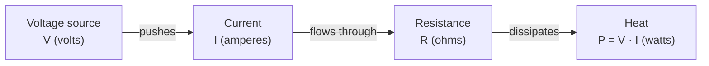

## Resistance and Ohm's law

**Resistance** measures how strongly a material opposes current flow. Its SI unit is the **ohm** ($\Omega$). For many materials over a wide range, the current through the material is proportional to the voltage across it:

$$
V = I \, R
$$

This is **Ohm's law**. Materials that obey it are called *ohmic*.

## The simplest circuit

The figure below shows the simplest complete circuit: a voltage source `V` driving a current `I` around a single loop through a resistor `R`.

<Figure caption="The simplest complete circuit: one source, one load, one current.">
  
</Figure>

The source supplies energy, and the load converts it. Because charge is conserved, the same current flows through every element in the loop. The relationship between the quantities follows one direction around the loop:

## Key takeaways

- Resistance $R$ ($\Omega$) opposes current.
- Ohm's law, $V = I \, R$, links the three quantities for ohmic materials.
- The same current flows through every element of a single loop.
