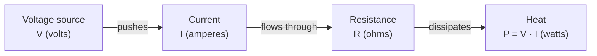

Circuit analysis rests on three quantities — **voltage**, **current**, and **resistance** — and one law that ties them together. This lesson defines each quantity and shows how to move between them.

## Charge and current

Electric current is the rate of flow of electric charge. If a net charge $\Delta Q$ passes through a cross-section of wire in time $\Delta t$, the current is:

$$
I = \frac{\Delta Q}{\Delta t}
$$

The SI unit of current is the **ampere** (A), where 1 A = 1 C/s. In metal wires the carriers are conduction electrons, but by convention current is treated as the flow of positive charge.

## Voltage

**Voltage** (potential difference) is the energy transferred per unit charge moving between two points:

$$
V = \frac{W}{Q}
$$

The SI unit is the **volt** (V), where 1 V = 1 J/C. A voltage is always measured *between* two points, never at a single point.

## Resistance and Ohm's law

**Resistance** measures how strongly a material opposes current flow; its SI unit is the **ohm** ($\Omega$). For many materials over a wide range, the current through the material is proportional to the voltage across it:

$$
V = I \, R
$$

This is **Ohm's law**. Materials that obey it are called *ohmic*.

## The simplest circuit

The figure below shows the simplest complete circuit: a voltage source `V` driving a current `I` around a single loop through a resistor `R`.

The source supplies energy; the load converts it. The same current flows through every element in the loop because charge is conserved. The relationship between the quantities follows one direction around the loop:

## Worked example

A 12 V battery is connected across a 220 Ω resistor. What current flows, and what power does the resistor dissipate?

1. Current, from Ohm's law: $I = V / R = 12\,\text{V} / 220\,\Omega \approx 54.5\,\text{mA}$
2. Power: $P = V \, I = 12\,\text{V} \times 0.0545\,\text{A} \approx 0.65\,\text{W}$

So a standard 0.25 W resistor would overheat here — component power ratings matter as much as resistance values.

## Key takeaways

- Current $I$ (A) is charge flow per unit time; voltage $V$ (V) is energy per unit charge; resistance $R$ ($\Omega$) opposes current.
- Ohm's law, $V = I \, R$, links the three for ohmic materials.
- Always pair a resistance value with its power rating when choosing components.
