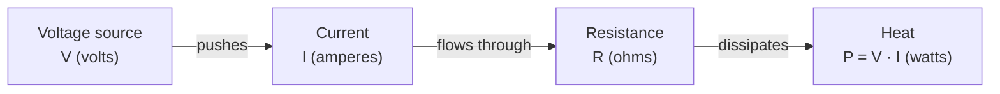

Circuit analysis rests on three quantities, **voltage**, **current**, and **resistance**, and on one law that ties them together. This lesson defines each quantity and shows how to move between them.

## Charge and current

Electric current is the rate of flow of electric charge. If a net charge $\Delta Q$ passes through a cross-section of wire in time $\Delta t$, the current is:

$$
I = \frac{\Delta Q}{\Delta t}
$$

The SI unit of current is the **ampere** (A), where 1 A = 1 C/s. In metal wires the carriers are conduction electrons, but by convention current is treated as the flow of positive charge.

## Voltage

**Voltage** (potential difference) is the energy transferred per unit charge moving between two points:

$$
V = \frac{W}{Q}
$$

The SI unit is the **volt** (V), where 1 V = 1 J/C. A voltage is always measured *between* two points, never at a single point.

<Callout variant="tip" title="Think in pairs">
  Whenever you see "the voltage at a point", ask "relative to what?". The reference node has to be defined first, because $V = W/Q$ only makes sense between two points. You will use this constantly once nodal analysis shows up.
</Callout>

## Resistance and Ohm's law

**Resistance** measures how strongly a material opposes current flow. Its SI unit is the **ohm** ($\Omega$). For many materials over a wide range, the current through the material is proportional to the voltage across it:

$$
V = I \, R
$$

This is **Ohm's law**. Materials that obey it are called *ohmic*.

## The simplest circuit

The figure below shows the simplest complete circuit: a voltage source `V` driving a current `I` around a single loop through a resistor `R`.

<Figure caption="The simplest complete circuit: one source, one load, one current.">
  
</Figure>

The source supplies energy, and the load converts it. Because charge is conserved, the same current flows through every element in the loop. The relationship between the quantities follows one direction around the loop:

## Worked example

A 12 V battery is connected across a 220 Ω resistor. What current flows, and what power does the resistor dissipate?

1. Current, from Ohm's law: $I = V / R = 12\,\text{V} / 220\,\Omega \approx 54.5\,\text{mA}$
2. Power: $P = V \, I = 12\,\text{V} \times 0.0545\,\text{A} \approx 0.65\,\text{W}$

<Callout variant="warning">
  A standard 0.25 W resistor would overheat in this circuit. Component power ratings matter as much as resistance values.
</Callout>

## Try it yourself

A space heater draws 4 A from a 230 V supply. What resistance does it present, and how much power does it dissipate?

<CollapsibleSolution>
  Resistance: $R = V / I = 230\,\text{V} / 4\,\text{A} = 57.5\,\Omega$.

  Power: $P = V \, I = 230\,\text{V} \times 4\,\text{A} = 920\,\text{W}$
  
  Consistent with $P = V^2/R = 230^2 / 57.5$.
</CollapsibleSolution>

## Key takeaways

- Current $I$ (A) is charge flow per unit time. Voltage $V$ (V) is energy per unit charge. Resistance $R$ ($\Omega$) opposes current.
- Ohm's law, $V = I \, R$, links the three for ohmic materials.
- Always pair a resistance value with its power rating when choosing components.

## Check your understanding

<Quiz
  question="Which of these follows from Ohm's law for a fixed resistance $R$?"
  options={[
    "Doubling $V$ doubles $I$",
    "Doubling $V$ halves $I$",
    "$I$ is independent of $V$",
    "$V = I / R$",
  ]}
  answer={0}
  explanation="From $V = I\,R$ with $R$ fixed, current scales linearly with voltage: $I = V / R$."
/>

<NumericQuiz
  question="A resistor dissipates $0.5\,\text{W}$ with $12\,\text{V}$ across it. What current flows through it?"
  answer={0.04167}
  tolerance={{ rel: 0.02 }}
  unit="A"
  explanation="From $P = V\,I$: $I = P / V = 0.5 / 12 \approx 41.7\,\text{mA}$."
/>
