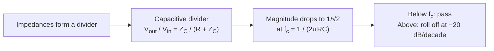

Resistors obey Ohm's law at every frequency. Capacitors do not. Their impedance falls as frequency rises. Put the two in series and you get a **frequency-dependent voltage divider**: the RC low-pass filter.

## The circuit

<Figure caption="A series RC network driven by a source. The output is taken across the capacitor.">
  
</Figure>

At low frequencies the capacitor barely conducts, almost no voltage drops across $R$, and $V_{out} \approx V_{in}$. At high frequencies the capacitor is nearly a short, so $V_{out}$ collapses toward zero. The boundary is the **cutoff frequency**:

$$
f_c = \frac{1}{2 \pi R C}
$$

With $R = 1\,\text{k}\Omega$ and $C = 100\,\text{nF}$, $f_c \approx 1591.5\,\text{Hz}$.

## Where the cutoff comes from

## Key takeaways

- The RC pair is a frequency-dependent divider.
- The cutoff sits at $f_c = 1/(2\pi R C)$.
