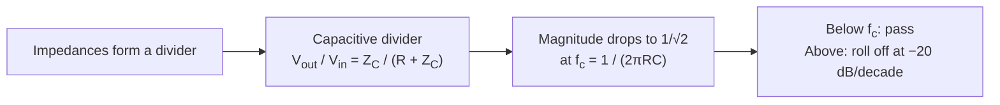

Resistors obey Ohm's law at every frequency. Capacitors do not — their impedance falls as frequency rises. Put the two in series and you get a **frequency-dependent voltage divider**: the RC low-pass filter.

## The circuit

<Figure caption="A series RC network driven by a source; the output is taken across the capacitor.">
  
</Figure>

At low frequencies the capacitor barely conducts, almost no voltage drops across $R$, and $V_{out} \approx V_{in}$. At high frequencies the capacitor is nearly a short, so $V_{out}$ collapses toward zero. The boundary is the **cutoff frequency**:

$$
f_c = \frac{1}{2 \pi R C}
$$

With $R = 1\,\text{k}\Omega$ and $C = 100\,\text{nF}$, $f_c \approx 1591.5\,\text{Hz}$.

## Step response

Switch the source on and the capacitor charges through the resistor with time constant $\tau = RC$. For the values above, $\tau = 0.1\,\text{ms}$ — after roughly $5\tau$ the capacitor is essentially fully charged.

<DataPlot src="./charging-curve.json" />

<Callout variant="note" title="Five time constants">
  The $5\tau$ rule of thumb is where the exponential reaches $99.3\%$ of its final value — "close enough" by engineering standards.
</Callout>

## Frequency response

A Bode plot shows the same story in the frequency domain: gain flat at low frequency, then rolling off at $-20\,\text{dB/decade}$ past $f_c$, with the phase swinging from $0°$ to $-90°$. Both panels share the same logarithmic frequency axis, so features line up vertically.

<DataPlot src="./bode.json" />

## Where the cutoff comes from

## Explore it yourself

Drag the sliders and watch the cutoff — and the whole magnitude curve — move. The formulas are exactly the ones above: $f_c = 1/(2\pi R C)$ and $|H| = 1/\sqrt{1 + (f/f_c)^2}$.

<Playground
  spec={{
    title: "RC low-pass explorer",
    params: [
      { name: "R", symbol: "R", min: 100, max: 10000, step: 100, default: 1000, unit: "Ω" },
      { name: "C", symbol: "C", min: 10, max: 1000, step: 10, default: 100, unit: "nF" },
    ],
    outputs: [
      { name: "Cutoff frequency", formula: "1 / (2 * pi * R * C * 1e-9)", unit: "Hz" },
      { name: "Time constant", formula: "R * C * 1e-9 * 1000", unit: "ms" },
    ],
    plot: {
      x: { variable: "f", label: "Frequency", unit: "Hz", min: 1, max: 1000000, log: true },
      y: {
        formula: "-10 * log10(1 + (2 * pi * f * R * C * 1e-9)^2)",
        label: "Magnitude",
        unit: "dB",
      },
    },
  }}
/>

## Check your understanding

<NumericQuiz
  question="With $R = 1\,\text{k}\Omega$ and $C = 100\,\text{nF}$, what is the cutoff frequency $f_c$?"
  answer={1591.5}
  tolerance={{ rel: 0.02 }}
  unit="Hz"
  explanation="$f_c = 1/(2\pi R C) = 1/(2\pi \times 10^3 \times 10^{-7}) \approx 1591.5\,\text{Hz}$ — about $1.59\,\text{kHz}$."
/>

## Key takeaways

- An RC low-pass passes low frequencies and attenuates high ones; $f_c = 1/(2\pi R C)$.
- In time, the same circuit charges with $\tau = RC$ — the two views are one circuit.
- The Bode magnitude and phase panels share the frequency axis by construction.
